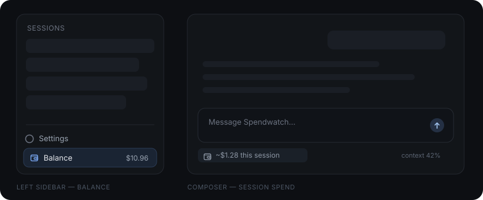

# Spendwatch

**A DeepSeek Harness plugin that keeps your DeepSeek balance and what each conversation costs in view.**

Spendwatch is an add-on for **DeepSeek Harness (DSH)**. Once installed, two small pieces of UI appear:

- **Your balance** — in the left sidebar, where you already look.
- **What this conversation has spent** — in a pill under the message box.

Both move on their own while you work, so you can watch the wallet drain without keeping the DeepSeek platform open in another tab.



*Illustration: the balance row at the bottom of the left sidebar, and the session pill in the dock under the composer.*

## Where things are

| Where | What you see | What it does when you touch it |
|---|---|---|
| Left sidebar, at the bottom (above **More**) | `Balance $10.96` | Hover for the all-time estimate and how many sessions it covers. Click to refresh now. |
| Left sidebar collapsed to the 56 px rail | a wallet icon | Hover — the tooltip still carries the balance and the estimate. |
| Under the message box, beside the context meter | `~$1.28 this session` | Hover for the split: the conversation's own spend, and the subagents it spawned. |

That's the whole plugin. No extra panels, no settings screen, no separate login.

## How it stays current

- **The balance is re-read from DeepSeek** whenever a running conversation adds to its cost, when you come back to the window, and when you click the row. Nothing polls while you're idle.
- **The session figure follows the tokens** each model call reports, so it moves as replies and tool calls land — including work done by subagents.
- **A forked conversation** is billed only for what it did after the fork, not for the history it inherited.

## What the numbers are (and aren't)

- The **balance** is the real wallet: whatever DeepSeek's API last told us.
- The **spend** is an **estimate**: tokens × DeepSeek's published list prices, including peak/off-peak and cache-hit/miss rates. It is not a billing record.
- Expect small differences. Unpriced models are skipped, public holidays aren't modelled, and DeepSeek's ledger can settle after the fact. **Don't reconcile an invoice with it.**
- Spendwatch is provided **as-is, without warranty** — it makes no promise of accuracy, completeness, or timeliness. Use it at your own risk.

## Install

1. In DSH, open **Plugins → Install**.
2. Choose **Git repository** and enter:

   ```
   https://github.com/awychoi/dsh-spendwatch
   ```

3. Restart DSH when prompted.

Spendwatch reads the wallet through your signed-in DeepSeek account, or through the `DEEPSEEK_API_KEY` credential if you use API keys. The key and any account token stay on the host and never reach the browser.

## Uninstall

Remove **Spendwatch** from DSH's plugin list and restart DSH. Nothing else is stored.

## License

[PolyForm Noncommercial License 1.0.0](LICENSE) — free to use, change, and share for **non-commercial purposes only**. The software comes as-is, with no warranty and no liability, to the extent the law allows.

Copyright © 2026 [awychoi](https://github.com/awychoi).

Not affiliated with DeepSeek.

---

## Technical notes

<details>
<summary>How it works, for the curious</summary>

**Host** ([`index.js`](index.js))

- Registers the `deepseekSpend` session projection: a pure fold over each session's `assistant/message` usage records, priced from DeepSeek's published per-million-token rates (peak/off-peak, cache-hit/miss, legacy aliases mapped to current models).
- Skips events below a session's `inheritedEventCount`, so fork-inherited history is never priced twice. `stateVersion: 2` invalidates checkpoints written by the earlier, double-counting state.
- Serves two read-only routes on the DSH Web server:
  - `GET /plugins/spendwatch/summary` — wallet plus the all-session estimate. The spend half is cached for 15 s; `refresh=1` bypasses it.
  - `GET /plugins/spendwatch/balance` — wallet only, no fold. Concurrent callers share one in-flight upstream read.

**Client** ([`client.js`](client.js))

- Registers `sidebar.footer.action` (root scope) and `conversation.composer.dock` (session scope) through DSH's slot API.
- The sidebar sums every session's live `deepseekSpend` from the root `useSessions` snapshot. The client receives control frames for every session whether or not its conversation is open, so background sessions and subagents count. When the sum rises it pulls `/balance`: debounced 200 ms, single-flight, with one queued trailing pull.
- The composer pill sums the current session's own view with every descendant marked `origin: "subagent"`, recursively. A subagent this app run has never loaded falls back to the `/summary` `bySession` fold.
- The wallet row sits above the host's existing footer action via a scoped `:has()` wrap; the collapsed rail shows the icon only.

**Files**

| File | Role |
|---|---|
| `index.js` | Host half: projection + routes |
| `client.js` | Client half: sidebar row + composer pill |
| `cordis.patch.yml` | Registers the bundle in a DSH profile |
| `locale/en.json`, `locale/zh.json` | Plugin-manager title and description |
| `icon.svg` | Plugin icon |

</details>
