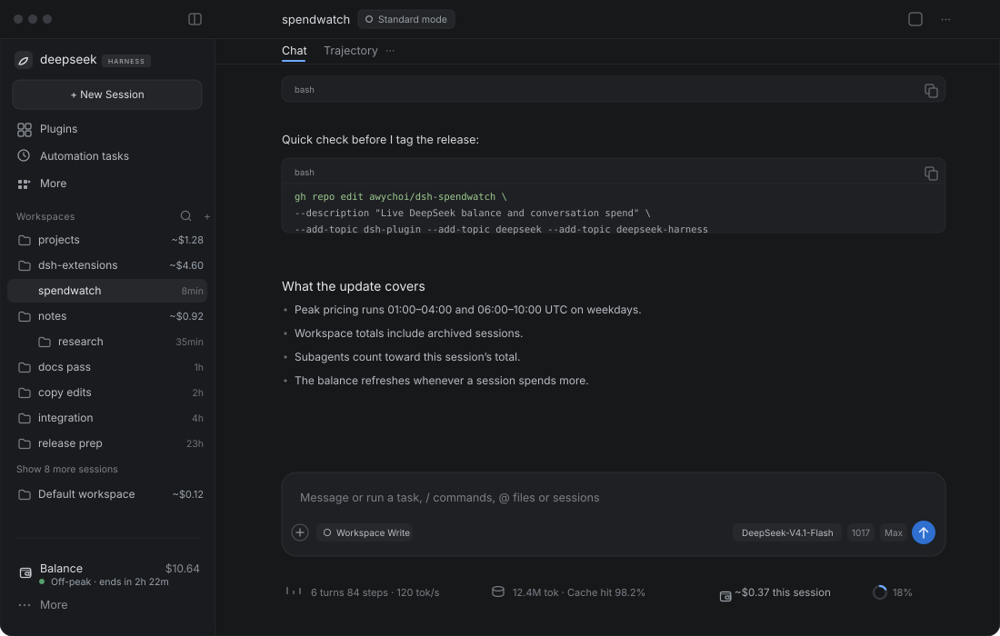

# Spendwatch

**A DeepSeek Harness plugin that keeps your DeepSeek balance and what each conversation costs in view.**

Spendwatch is an add-on for **DeepSeek Harness (DSH)**. Once installed, it puts the money where you're already looking:

- **Your balance** — in the left sidebar, with a live **peak / off-peak** marker and a countdown to the next pricing flip.
- **What each workspace has spent** — right on the workspace row, archived sessions included.
- **What this conversation has spent** — in a pill under the message box, subagents included.

They move on their own while you work, so you can watch the wallet drain without keeping the DeepSeek platform open in another tab.



## Where things are

| Where | What you see | What it does when you touch it |
|---|---|---|
| Left sidebar, at the bottom (above **More**) | `Balance $10.64` | Hover for the all-time estimate and how many sessions it covers. Click to refresh now. |
| Under the balance | `● Off-peak · ends in 2h 22m` | DeepSeek's current pricing window, with a live countdown to the next flip. Hover for the flip time in your local clock. |
| On each workspace row, right-aligned | `~$1.28` | Estimated spend for every session in that workspace — archived sessions included. Hover for the workspace name and the figure. |
| Left sidebar collapsed to the 56 px rail | a wallet icon | Hover — the tooltip still carries the balance and the estimate. |
| Under the message box, beside the context meter | `~$0.37 this session` | Hover for the split: the conversation's own spend, and the subagents it spawned. |

That's the whole plugin. No extra panels, no settings screen, no separate login.

## How it stays current

- **The balance is re-read from DeepSeek** whenever a running conversation adds to its cost, when you come back to the window, and when you click the row. Nothing polls while you're idle.
- **The session figure follows the tokens** each model call reports, so it moves as replies and tool calls land — including work done by subagents.
- **A forked conversation** is billed only for what it did after the fork, not for the history it inherited.
- **The pricing marker** follows DeepSeek's schedule — peak is 01:00–04:00 and 06:00–10:00 UTC, Monday to Friday — and re-evaluates every 10 seconds. It needs no network call.
- **Workspace totals** come from the same durable fold, attributed through the official workspace registry's membership (`workspace.sessionIds`, with a cwd fallback for unowned sessions), so archived sessions count. Sessions running now add their live spend on top of the last fold.

## What the numbers are (and aren't)

- The **balance** is the real wallet: whatever DeepSeek's API last told us.
- The **spend** is an **estimate**: tokens × DeepSeek's published list prices, including peak/off-peak and cache-hit/miss rates. It is not a billing record.
- Expect small differences. Unpriced models are skipped, public holidays aren't modelled, and DeepSeek's ledger can settle after the fact. **Don't reconcile an invoice with it.**
- The peak/off-peak marker follows the plain weekday schedule; Chinese public holidays aren't modelled there either, so it can disagree with DeepSeek on those days.
- Spendwatch is provided **as-is, without warranty** — it makes no promise of accuracy, completeness, or timeliness. Use it at your own risk.

## Compatibility

Built against **DSH 0.2.x**. Spendwatch has no build step, no npm dependencies, and stores nothing of its own.

- It rides DSH's extension surfaces: the plugin bundle format, the `sidebar.footer.action` and `conversation.composer.dock` slots, the `sessionProjections` seam, and the `sessionQuery` / `workspaceRegistry` services. A release that renames one of those will need a matching update.
- It degrades instead of breaking: without `sessionQuery` the spend figures are unavailable but the balance still works; without `workspaceRegistry` (or `useWorkspaces`) the workspace badges are skipped; without `deepseekAccount` it falls back to `DEEPSEEK_API_KEY`. Each slot entry sits behind a crash boundary, so a render error falls back to the shipped UI rather than blanking it.
- The **workspace badges are the least stable piece.** DSH has no per-workspace slot, so they attach to the shipped row through `data-row-key`. If a release changes that attribute, the badges disappear and nothing else is affected.
- After a DSH update, reload the page (client half) and restart DSH (Host half), then check the three surfaces: sidebar balance, workspace totals, composer pill.

## Install

1. In DSH, open **Plugins → Install**.
2. Choose **Git repository** and enter:

   ```
   https://github.com/awychoi/dsh-spendwatch
   ```

3. Restart DSH when prompted.

Spendwatch reads the wallet through your signed-in DeepSeek account, or through the `DEEPSEEK_API_KEY` credential if you use API keys. The key and any account token stay on the host and never reach the browser.

## Uninstall

Remove **Spendwatch** from DSH's plugin list and restart DSH. Nothing else is stored.

## License

[PolyForm Noncommercial License 1.0.0](LICENSE) — free to use, change, and share for **non-commercial purposes only**. The software comes as-is, with no warranty and no liability, to the extent the law allows.

Copyright © 2026 [awychoi](https://github.com/awychoi).

Not affiliated with DeepSeek.

---

## Technical notes

<details>
<summary>How it works, for the curious</summary>

**Host** ([`index.js`](index.js))

- Registers the `deepseekSpend` session projection: a pure fold over each session's `assistant/message` usage records, priced from DeepSeek's published per-million-token rates (peak/off-peak, cache-hit/miss, legacy aliases mapped to current models).
- Skips events below a session's `inheritedEventCount`, so fork-inherited history is never priced twice. `stateVersion: 2` invalidates checkpoints written by the earlier, double-counting state.
- Serves two read-only routes on the DSH Web server:
  - `GET /plugins/spendwatch/summary` — wallet plus the all-session estimate. The spend half is cached for 15 s; `refresh=1` bypasses it.
  - `GET /plugins/spendwatch/balance` — wallet only, no fold. Concurrent callers share one in-flight upstream read.

**Client** ([`client.js`](client.js))

- Registers `sidebar.footer.action` (root scope) and `conversation.composer.dock` (session scope) through DSH's slot API.
- The sidebar computes the peak/off-peak marker locally from the same rule as the Host's `isPeak` (01:00–04:00 and 06:00–10:00 UTC, Mon–Fri), ticks every 10 s, and renders the next flip as a countdown plus a local clock time in the tooltip.
- The Host folds spend per Workspace id (`byWorkspace` in `/summary`): each Session is attributed through `workspaceRegistry.list()` membership, the same account the sidebar renders, so archived Sessions keep their place; unowned Sessions (subagents, deleted registrations) fall back to their `cwd`. The Client adds only the post-fold delta for Sessions it has live projections for, then attaches the total to the shipped workspace row identified by `data-row-key="workspace:<id>"` — DSH has no per-workspace slot. If that attribute ever changes, the badges simply stop appearing; nothing else breaks.
- Both slot entries are wrapped in a crash boundary that logs the error and re-throws, so a render failure falls back to the shipped UI instead of abdicating silently with no trace.
- The sidebar sums every session's live `deepseekSpend` from the root `useSessions` snapshot. The client receives control frames for every session whether or not its conversation is open, so background sessions and subagents count. When the sum rises it pulls `/balance`: debounced 200 ms, single-flight, with one queued trailing pull.
- The composer pill sums the current session's own view with every descendant marked `origin: "subagent"`, recursively. A subagent this app run has never loaded falls back to the `/summary` `bySession` fold.
- The wallet row sits above the host's existing footer action via a scoped `:has()` wrap; the collapsed rail shows the icon only.

**Files**

| File | Role |
|---|---|
| `index.js` | Host half: projection + routes |
| `client.js` | Client half: sidebar row + composer pill |
| `cordis.patch.yml` | Registers the bundle in a DSH profile |
| `locale/en.json`, `locale/zh.json` | Plugin-manager title and description |
| `icon.svg` | Plugin icon |

</details>
