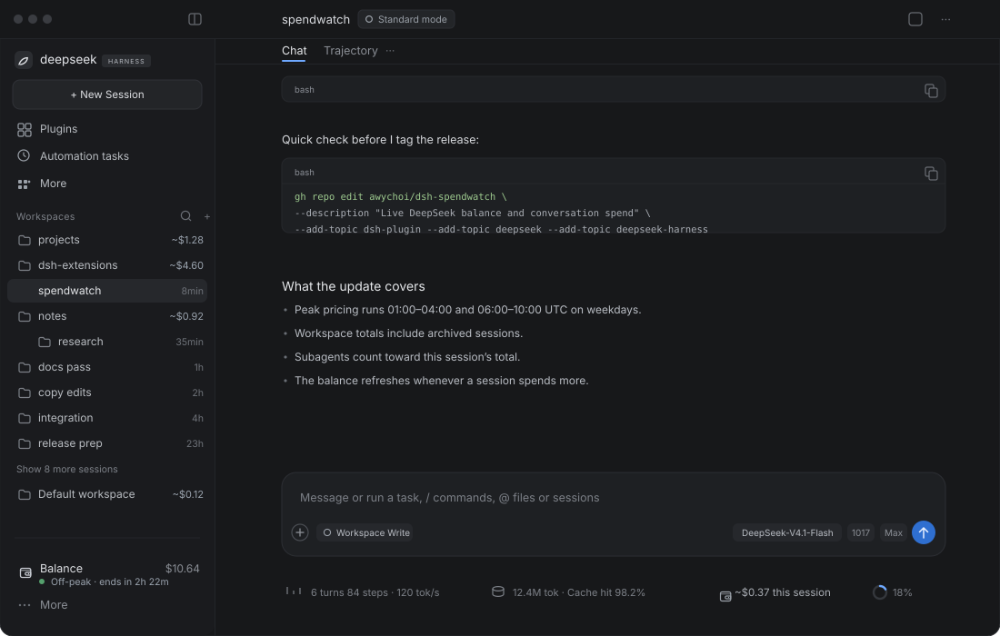

#  Spendwatch

**A DeepSeek Harness plugin that keeps your DeepSeek balance, what each
conversation costs, and what each workspace has spent in view.**

Spendwatch puts your wallet, the current conversation, and every workspace in
view at once. Workspace totals are the unusual part: they roll up all of a
workspace's sessions, archived ones included, not just the conversation you have
open. It reads the same DeepSeek account DSH uses, so there is no extra login or
settings screen.

## What you get

- **Your balance** in the left sidebar, with a live peak / off-peak marker and
  a countdown to the next pricing flip.
- **Workspace totals** on each workspace row: every session in that workspace,
  archived ones included.
- **Conversation spend** in a pill under the message box, subagents included.

## How it stays current

The balance is re-read when a conversation adds spend, when you return to the
window, or when you click it. It does not poll while idle. The wallet has its
own route, so the all-session spend fold cannot hold it up. Session totals
follow the usage each model call reports, and a forked conversation is billed
only for what it did after the fork. Workspace totals add live sessions on top
of the durable fold, so archived sessions still count.

The peak / off-peak marker is derived from the same price book the Host uses,
re-evaluates every 10 seconds, and includes the Beijing weekday rule and Chinese
public holidays.

## Accuracy

- The **balance** is the real wallet value last returned by DeepSeek.
- The **spend** is an estimate: tokens × published list prices, including
  peak/off-peak and cache-hit/miss rates. Unpriced models are skipped. Native
  search runs as an auxiliary model turn; the session log records the request
  but not its usage, so the Host estimates `search.estimatedInputTokens` +
  `search.estimatedOutputTokens` per request at the search model's rates. That
  estimate is approximate and tunable in `pricing.json`. The Search/Fetch APIs
  bill $0.75 per 1K successful requests, but this profile uses Messages search
  and local HTTP fetch, so that fee is not incurred. The search count includes
  requests that later failed.
- Chinese public holidays are covered through 2026; add the 2027 dates when they
  are announced.
- Do not reconcile an invoice with Spendwatch. DeepSeek's ledger can settle
  after the fact.

## Technical notes

Built against DSH 0.2.x; the host-coupling notes below are the parts most likely to need attention on upgrades.

- **Fork accounting:** the Host fold skips events below a session's
  `inheritedEventCount`, so inherited history is not billed twice.
- **Search accounting:** every `web/deepseek-search-llm-request` event (one per
  query) adds one to `searchRequests` and prices the period's estimated search
  tokens (`search.estimatedInputTokens` / `estimatedOutputTokens`) at the search
  model's rates. The estimate comes from observed request/result sizes; the
  real auxiliary usage is not logged. The Search/Fetch APIs' $0.75/1K
  per-successful-request billing is not modelled because this profile uses
  Messages search and local HTTP fetch, which produce no API request events.
- **Host coupling:** DSH has no per-workspace slot, so workspace totals attach
  to the shipped row through `data-row-key="workspace:<id>"`; the wallet row
  sits above the footer action through a scoped `:has()` wrap. If either host
  detail changes, only that surface disappears.
- **Failure isolation:** the sidebar and composer entries each sit behind a
  crash boundary. Missing optional services degrade individually — no
  `sessionQuery` drops spend figures, no `workspaceRegistry` drops workspace
  badges, and a missing or failed `deepseekAccount` falls back to `DEEPSEEK_API_KEY`.
- **Pricing book:** the Host validates `pricing.json` at startup and serves it
  to the Client, falling back to the bundled copy if the file is malformed or
  missing. To update token rates, search token estimates, or holidays, add a
  period with its effective `from` instant and restart DSH.

## Install

1. In DSH, open **Plugins → Install**.
2. Choose **Git repository** and enter
   `https://github.com/awychoi/dsh-spendwatch`.
3. Restart DSH when prompted.

Spendwatch prefers the signed-in DeepSeek account. If that read fails or the
account is not connected, it falls back to `DEEPSEEK_API_KEY`, which reads the
same wallet through the public API. Credentials stay on the Host and never
reach the browser.

## Uninstall

Remove **Spendwatch** from DSH's plugin list and restart DSH. Nothing else is
stored.

## Assets

`icon.svg` is the plugin icon. `icon-white.svg` is the transparent solid-white
mark for dark backgrounds. Exported as `./icon` and `./icon-white`.

## License

[MIT](LICENSE) — free to use, change, and share, including commercially.
Copyright © 2026 [awychoi](https://github.com/awychoi).

Not affiliated with DeepSeek.
